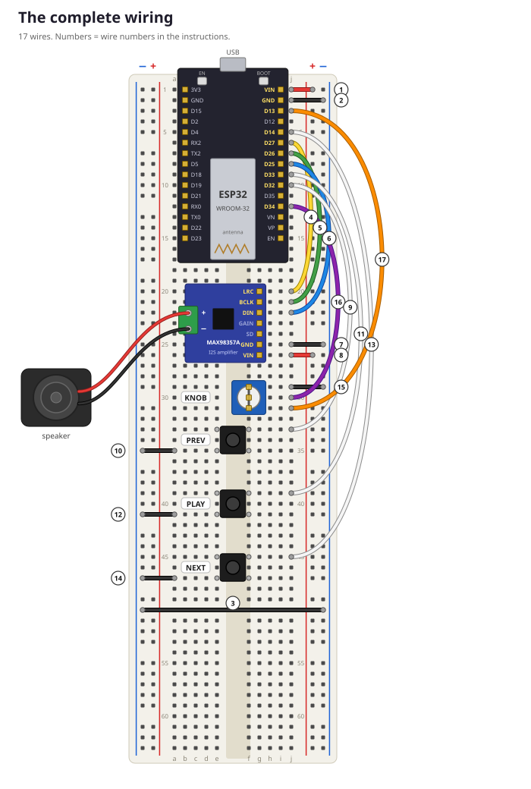
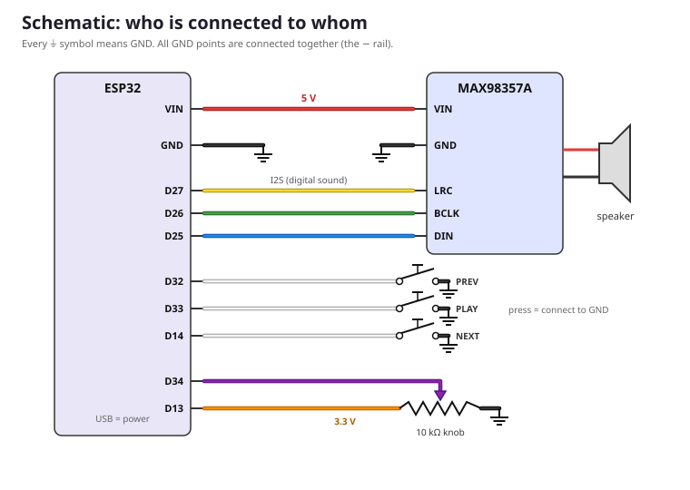

# 🎵 WiFi Breadboard MP3 Player

Build your own MP3 player on a breadboard! You pick songs in a web app in your browser. The music flies over WiFi to an **ESP32** microcontroller, which plays it through a small amplifier and speaker. Three buttons and a volume knob on the breadboard work like a remote control.



**No soldering needed** (except maybe the speaker wires, see the parent guide). This project is made for two builders aged 12–14, each with their own player.

## Lessons

| # | Lesson | What you do |
|---|---|---|
| 0 | [Parent / mentor guide](docs/00_parent_guide.md) | shopping list, preparation, session plan (for grown-ups) |
| 1 | [Meet the parts](docs/01_meet_the_parts.md) | what every part does, how a breadboard works |
| 2 | [Setup and Blink](docs/02_setup_and_blink.md) | your first program |
| 3 | [Build part 1: sound](docs/03_build_part1_sound.md) | ESP32 + amplifier + speaker, play a melody |
| 4 | [Build part 2: buttons and knob](docs/04_build_part2_controls.md) | add the controls |
| 5 | [WiFi](docs/05_wifi.md) | connect to the network |
| 6 | [The MP3 player](docs/06_the_mp3_player.md) | 🎶 play music from the web app |
| 7 | [How it works](docs/07_how_it_works.md) | samples, WebSockets, buffers, credits |
| 8 | [Challenges](docs/08_challenges.md) | make it your own |
| extra | [Headphones](docs/09_extra_headphones.md) | optional: add a headphone socket (step 7) |
| | [Troubleshooting](docs/troubleshooting.md) | when something doesn't work |

## What's in this folder

```
wifi_mp3_player/
├── docs/                       the lessons (start here!) and pictures
├── firmware/                   code for the ESP32 (Arduino)
│   ├── tests/01_blink          test 1: blink the LED
│   ├── tests/02_first_sound    test 2: play a melody (checks amplifier + speaker)
│   ├── tests/03_buttons_knob   test 3: read the buttons and knob
│   ├── tests/04_wifi           test 4: connect to WiFi
│   └── mp3_player              the real MP3 player program
├── webapp/                     the web app: open index.html in Chrome or Edge
└── tools/
    ├── fake_device.py          pretend to be a player (test the web app without hardware)
    └── make_diagrams.py        draws the wiring pictures in docs/images
```

## Parts for one player (about €30)

ESP32 dev board (30-pin), MAX98357A I2S amplifier, 8 Ω speaker, 830-hole breadboard, 3 push buttons, a 10 kΩ knob and 17 jumper wires. See the [parent guide](docs/00_parent_guide.md#shopping-list-bits--parts-prices-checked-10-nov-2026) for the full shopping list with links.

**Optional:** a UDA1334A I2S DAC board (€7.95) adds a headphone socket, with 5 more wires and no code changes. See [Extra: Headphones](docs/09_extra_headphones.md).

## Wiring at a glance

| ESP32 pin | Goes to | Wire |
|---|---|---|
| VIN | + rail → amplifier VIN | red |
| GND | − rail → amplifier GND, buttons, knob | black |
| D27 | amplifier LRC | yellow |
| D26 | amplifier BCLK | green |
| D25 | amplifier DIN | blue |
| D32 / D33 / D14 | buttons PREV / PLAY / NEXT (other leg to GND) | white |
| D34 | knob, middle leg | purple |
| D13 | knob, outer leg (3.3 V) | orange |



## How it works, in one paragraph

The web app decodes the MP3 in the browser, resamples it to 22050 samples per second (mono, 16-bit) and sends it in chunks of 1024 samples over a WebSocket. The ESP32 keeps about 0.75 s of sound in a buffer and sends it to the amplifier over I2S. For every chunk it plays, it sends a "credit" back, so the web app never sends more than fits in the buffer. Read [lesson 7](docs/07_how_it_works.md) for the full story.
