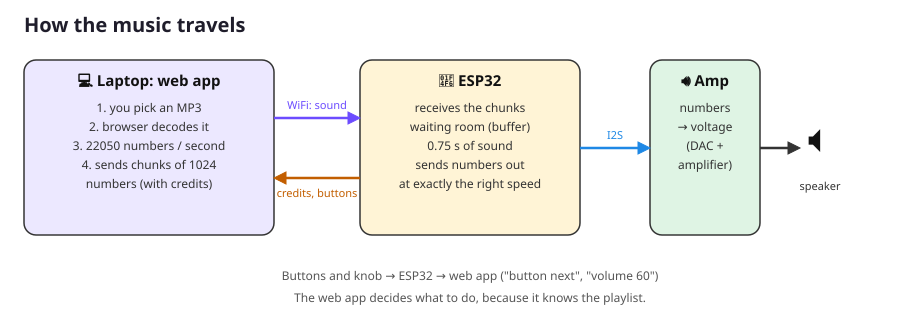

# Parent / mentor guide

This page is for **you**, the older sibling or parent who runs the project. The other lessons are written for the kids (ages about 12–14).

## What we're building

Two identical WiFi MP3 players on breadboards, one per kid. Each player is an **ESP32** microcontroller, a **MAX98357A** I2S amplifier, a speaker, three buttons and a volume knob. A **web app** in the browser decodes MP3 files and streams the raw audio samples over WiFi (WebSocket) to the ESP32, which plays them.



The MP3 decoding happens **in the browser**, not on the ESP32. This keeps the firmware short enough for the kids to read, and teaches them what digital audio actually is: a long list of numbers.

## Shopping list (Bits & Parts, prices checked 10 Nov 2026)

Everything comes from [bitsandparts.nl](https://www.bitsandparts.nl), a Dutch shop with fast shipping inside NL.

| Qty | Item | Each | Total |
|---|---|---|---|
| 2 | [ESP32 Development board WiFi/Bluetooth, 30-pin, micro-USB, soldered pins](https://www.bitsandparts.nl/en/esp32-development-board-wifi-bluetooth-p1905271) | €10.95 | €21.90 |
| 2 | [MAX98357A I2S 3W class D amplifier, presoldered pins](https://www.bitsandparts.nl/en/audio-amplifier-3w-class-d-i2s-breakout-max98357a-presoldered-pins-p1924314) | €5.95 | €11.90 |
| 1 | [Speaker set 8 Ω 5 W in enclosure (set of **two**)](https://www.bitsandparts.nl/en/speaker-set-8-ohm-5-watt-stereo-in-enclosure-p1931808), one speaker per player | €6.95 | €6.95 |
| 2 | [Breadboard 830 holes](https://www.bitsandparts.nl/en/breadboard-830-pins-mb102-universal-experimenting-board-clear-p121068) | €3.95 | €7.90 |
| 8 | [Push button 6x6x5 mm breadboard-friendly](https://www.bitsandparts.nl/en/microswitch-push-button-(make-contact)-6x6x5mm-breadboard-friendly-p1911251) (6 + 2 spare) | €0.15 | €1.20 |
| 2 | [10 kΩ trim potentiometer, Adafruit 356](https://www.bitsandparts.nl/en/adjustable-resistance-precision-potentiometer-10k-adafruit-356-p118111) | €1.70 | €3.40 |
| 2 | [Jumper wires male/male, 65 pcs](https://www.bitsandparts.nl/en/breadboard-jumper-cables-male-male-65pcs-p1905692) | €2.95 | €5.90 |
| | **Subtotal** | | **€59.15** |
| | Shipping (parcel, free above €80) | | €5.95 |
| | **Total** | | **≈ €65** |

**Saving about €3.50:**
- Share one jumper-wire pack between the two builds. Each build uses 17 wires, or 23 with the headphone step. With headphones, keep both packs: each build needs 5 of the longest wires.
- Use [3362P trimmers](https://www.bitsandparts.nl/en/adjustable-resistance-trimmer-potentiometer-type-3362p-10k-ohm-p106526) (€0.40) instead of the Adafruit 356. You turn them with a small screwdriver, not your fingers.

### Optional add-on: headphones
| Qty | Item | Each | Total |
|---|---|---|---|
| 2 | [UDA1334A I2S stereo DAC with 3.5 mm headphone socket](https://www.bitsandparts.nl/en/audio-decoder-stereo-dac-i2s-uda1334a-p1926826) | €7.95 | €15.90 |

The DAC sits on the same three I2S wires as the amplifier, so no code changes are needed. Each build gets 5 more wires, plus an optional speaker-off wire. Three of them run from row 20 to row 60, so use the longest wires in the pack. The DAC's 9-pin strip has to be soldered on. See [Extra: Headphones](09_extra_headphones.md). Its output is line level, roughly 0.9 V: that's plenty for normal 32 Ω headphones and earbuds, and much gentler on ears than a dedicated headphone amplifier.

**You also need** (you said you already have these): two USB data cables (micro-USB), a laptop with Chrome or Edge, a small screwdriver and a soldering iron.

## Before the first session: prep (about 1 hour)

### 1. Check the parts
The shop pages don't say these things, so check when the box arrives:

- **Speaker cable ends.** If the speaker cable ends in a plug instead of bare wire, cut the plug off, strip 5 mm of insulation and twist the strands. Tinning them with a bit of solder helps them go into the screw terminal.
- **Amplifier screw terminal.** The MAX98357A board comes with header pins presoldered. Check whether the green screw terminal for the speaker is also soldered on. If it's loose in the bag, solder it on, with the screw openings facing outward.
- **Headphone DAC (if you got it).** The 9-pin strip comes loose. Soldering it is a nice first soldering job for the kids, under supervision (see the lesson). If you'd rather do it yourself, push the long pin ends into the breadboard at `h55`–`h63` and solder with the labels facing up. Only the strip on the VIN … Rout side is needed.
- **USB-to-serial chip.** Look at the small chip near the ESP32's USB port.
  - "CP2102" (or CP210x) needs the [Silicon Labs CP210x driver](https://www.silabs.com/developers/usb-to-uart-bridge-vcp-drivers).
  - "CH340" or "CH9102" needs the [WCH CH340/CH341 driver](https://www.wch-ic.com/downloads/CH341SER_EXE.html).
  - Linux and recent macOS usually need no driver.

### 2. Install the software on the kids' laptop
1. Install **Arduino IDE 2** from <https://www.arduino.cc/en/software>.
2. In the IDE: **File → Preferences → Additional boards manager URLs**, add:
   `https://espressif.github.io/arduino-esp32/package_esp32_index.json`
3. **Tools → Board → Boards Manager**: search `esp32` and install **"esp32 by Espressif Systems"** (version 3.x). This is a big download.
4. **Tools → Manage Libraries**: search `WebSockets` and install **"WebSockets" by Markus Sattler**.
5. Install the USB driver from step 1, if needed.
6. **Linux only:** add the user to the `dialout` group (`sudo usermod -aG dialout $USER`, then log out and in). On Ubuntu, also remove `brltty` (`sudo apt remove brltty`), because it steals CH340 USB devices.
7. Copy this whole `wifi_mp3_player` folder to the laptop, or `git clone` the repo.

### 3. Test both ESP32 boards
Upload `firmware/tests/01_blink` to each board. If the blue LED blinks, the cable, driver and IDE all work. Better to find a bad cable now than in the middle of a lesson.

### 4. WiFi details
The ESP32 only works with **2.4 GHz** WiFi. Most home routers broadcast 2.4 GHz and 5 GHz under the same name, and that is fine. Eduroam-style networks with username + password will **not** work. A phone hotspot works as a fallback.

The kids will put the WiFi name and password in a file called `secrets.h`. This file is listed in `.gitignore`, so it is never committed.

### 5. Give each player its own name
Player 1 uses `mp3player-1` (the default). For the second player, the kid changes `DEVICE_NAME` in `firmware/mp3_player/config.h` to `mp3player-2`, or something they like better, for example `lisa-speaker`. Use only letters, digits and `-`.

## Session plan

| # | Lesson | Time | Result |
|---|---|---|---|
| 1 | [Meet the parts](01_meet_the_parts.md) | 30 min | knows every part and how a breadboard works |
| 2 | [Setup and Blink](02_setup_and_blink.md) | 45 min | first program uploaded |
| 3 | [Build part 1: sound](03_build_part1_sound.md) | 60 min | ESP32 + amplifier + speaker wired, plays a melody |
| 4 | [Build part 2: buttons and knob](04_build_part2_controls.md) | 45 min | buttons and knob work in the Serial Monitor |
| 5 | [WiFi](05_wifi.md) | 30 min | ESP32 on the network, IP address known |
| 6 | [The MP3 player](06_the_mp3_player.md) | 45 min | music from the web app! |
| 7 | [How it works](07_how_it_works.md) | 45 min | understands samples, WebSockets, buffers |
| 8+ | [Challenges](08_challenges.md) | as long as they like | their own features |
| extra | [Headphones](09_extra_headphones.md) (optional, any time after lesson 4) | 45 min | headphone socket; first soldering job |

Let them build their own boards side by side, doing each step at the same time. They can check each other's work, and that catches most mistakes. **Let them make mistakes.** Finding a wire in the wrong row is the most valuable skill in this whole project. Show them [troubleshooting.md](troubleshooting.md) instead of fixing it for them.

## Safety and good habits
- **Unplug USB before changing wires.** It's not dangerous at 5 V, but a misplaced wire can damage the ESP32.
- The **+ rail carries 5 V** and only goes to the amplifier's VIN. It must **never** touch a GPIO pin, because ESP32 pins only tolerate 3.3 V. The wiring in this project never needs it to.
- Red = 5 V, black = GND. Keep that habit even if the wire pack has other colours.
- Start with the volume knob low. The 5 W speakers can get surprisingly loud right next to your ear. The same goes for headphones: the lesson tells the kids to start at volume 20 or lower.
- Soldering (headphone step only): supervise, use the stand, ventilate, wash hands afterwards.
- Only use MP3s you own, or free music. For example, the [YouTube Audio Library](https://www.youtube.com/audiolibrary) and [Free Music Archive](https://freemusicarchive.org) have free tracks.

## Testing the web app without hardware
`tools/fake_device.py` pretends to be a player, which is handy before the parts arrive:

```bash
cd wifi_mp3_player/tools
python3 -m venv .venv && . .venv/bin/activate   # Windows: .venv\Scripts\activate
pip install -r requirements.txt
python fake_device.py
```

1. Open `webapp/index.html` and connect to `localhost:8181`. Songs "play" at real speed.
2. Type `prev`, `play`, `next` or `volume 30` in the terminal to simulate the hardware.
3. Everything received is saved to `received.wav`. Play it to hear exactly what the ESP32 would have played.

## Changing the wiring pictures
All breadboard pictures are generated by `tools/make_diagrams.py` from one list of wires. If you change a pin, update `firmware/mp3_player/config.h` **and** the `WIRES` list in that script, then run `python3 make_diagrams.py`.
