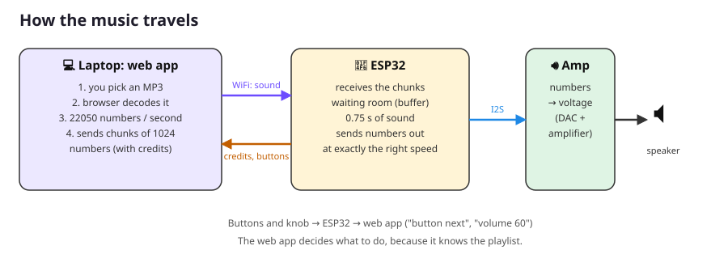
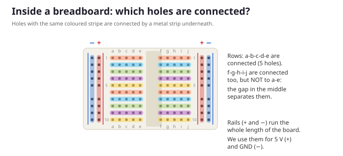

# Lesson 1: Meet the parts

**Goal:** know what every part does, and how a breadboard works.
**Time:** about 30 minutes. **You need:** your box of parts. No computer yet!

---

## What are we building?

A **WiFi MP3 player**. You choose music in your web browser, it flies through the air over WiFi, and comes out of a speaker on your breadboard. The buttons on the breadboard work like a remote control.

Take each part out of the box while you read about it.

## The parts

### 🧠 ESP32: the brain
The black board with the silver box on it. It's a tiny computer, called a **microcontroller**.
- It runs **one program**, the one you upload to it.
- It has **WiFi** built in. That's what the silver box with the zigzag line is: the zigzag is the antenna!
- Along both sides it has **pins**: little metal legs. Each pin has a name printed next to it, like `D25` or `GND`. Most pins are **GPIO** pins (General Purpose Input/Output). Your program decides whether a pin *listens* (input) or *sends* (output).
- It gets its power (5 volts) from the **USB cable**.

> 🔍 **Look closely:** find the pins named `VIN`, `GND`, `D25`, `D26` and `D27`. Find the two tiny buttons, `EN` (restart) and `BOOT`.

### 🔊 MAX98357A: the amplifier
The small blue board with 7 pins in a row and a green connector.

The ESP32 can only send out tiny digital signals: numbers. A speaker needs real power to move. The amplifier does two things:
1. It turns numbers into a voltage that goes up and down. This is called a **DAC**, a Digital-to-Analog Converter.
2. It makes that voltage strong enough to push the speaker. That's the **amplifier** part.

The ESP32 talks to it over **I2S** (say "eye-squared-ess"), a special 3-wire "cable" made for digital sound.

### 📢 Speaker
A paper or plastic cone with a magnet and a coil of wire behind it. When the amplifier sends electricity through the coil, it becomes a magnet that pushes and pulls the cone. The cone pushes the air, and you hear sound!

### 🔘 Buttons (×3)
The tiny square things with four legs. When you press one, two of its legs get connected inside. We have three: **PREV** (previous song), **PLAY/PAUSE** and **NEXT**.

### 🎛️ Knob (potentiometer)
The small part with a knob you can turn and three legs. Inside is a strip of material that slightly resists electricity, plus a metal finger (connected to the middle leg) that slides along it when you turn the knob. Depending on where the finger is, the middle leg gets a voltage somewhere between 0 and 3.3 volts. The ESP32 measures that voltage, and we use it for the **volume**.

### 🔌 Jumper wires
Wires with a pin on each end. They connect things on the breadboard.

### 🟫 The breadboard
The white board full of holes. It lets you build circuits **without soldering**: you just push wires and parts into the holes.

## How a breadboard works

Inside the breadboard are metal strips that connect some holes to each other. **Holes on the same strip are connected**, exactly as if you had put a wire between them.

- Each **row** has two strips of 5 holes: `a b c d e` on the left, and `f g h i j` on the right.
- The **gap in the middle** separates them. Row 10 `a-e` is *not* connected to row 10 `f-j`.
- The long lines on the sides are the **rails**. They run (almost) the whole length of the board. We use the **+ rail (red line) for 5 V** and the **− rail (blue line) for GND**.
- Each hole has an address, like in a game of Battleship: **`j6`** means column j, row 6.

> ⚠️ Some breadboards have a break in the middle of the rails. Look carefully at the red and blue lines: if there is a gap in the line halfway, the rail is split into two halves. We'll fix that with an extra wire when we need it.

## What is "GND"?
**GND** means **ground**. Electricity always needs to flow in a circle: out of the power source, through the part, and *back*. GND is the "back" path, at 0 volts. Almost every part has a GND pin, and all the GNDs must be connected together.

---

## ✅ What did you learn?
- [ ] The ESP32 is the brain, and it has WiFi.
- [ ] The amplifier turns numbers into sound strong enough for a speaker.
- [ ] Holes in the same row half (`a-e` or `f-j`) are connected.
- [ ] The rails are for 5 V (+) and GND (−).

## 🤔 Quiz

1. Are holes `c12` and `e12` connected?
2. Are holes `e12` and `f12` connected?
3. Why can't the ESP32 drive a speaker by itself?
4. What does GND mean, and why does every part need it?

Answers

1. Yes: same row, same half (a-e).
2. No: the gap in the middle separates them.
3. Its pins can only give a tiny amount of power, and only digital signals (on/off). The amplifier turns the numbers into a strong, smoothly changing voltage.
4. Ground, 0 volts: the path for electricity to flow back. Without a complete circle, no electricity flows.

**Next:** [Lesson 2: Setup and Blink](02_setup_and_blink.md)
