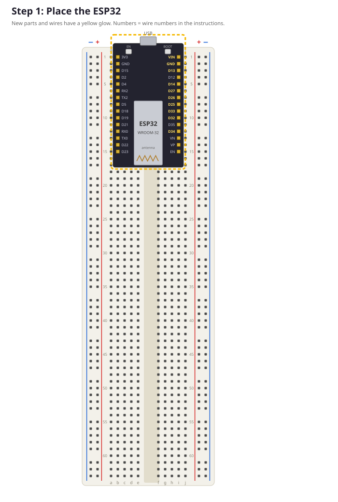
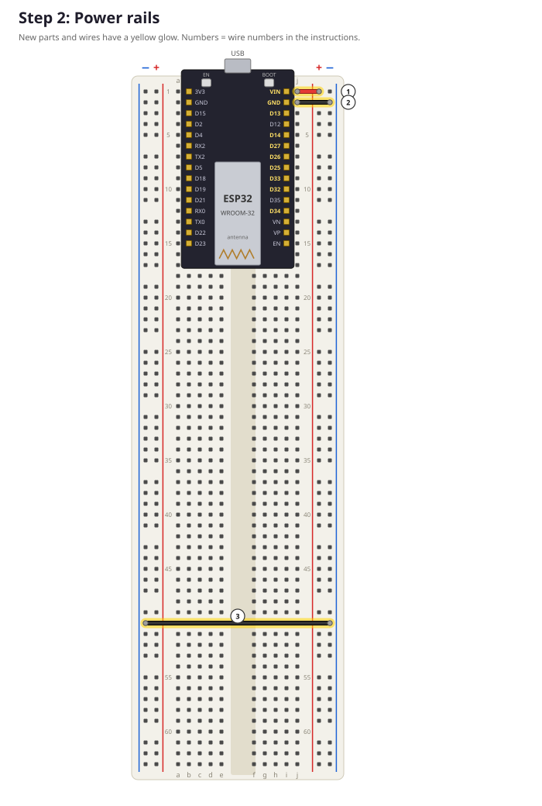
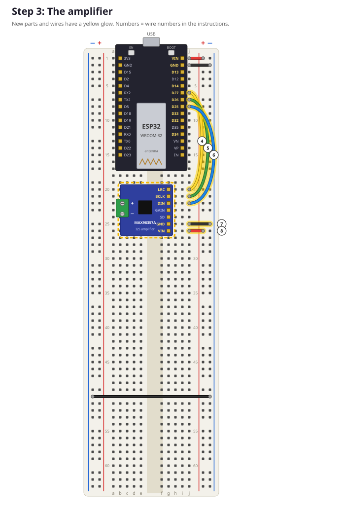
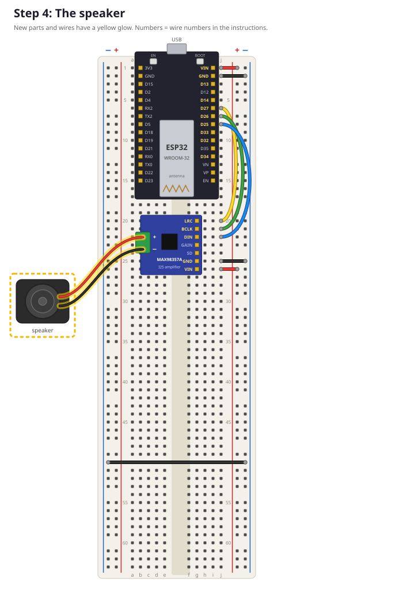

# Lesson 3: Build part 1, sound

**Goal:** wire up the ESP32, amplifier and speaker, and play your own melody.
**Time:** about 60 minutes. **You need:** breadboard, ESP32, amplifier, speaker, jumper wires, small screwdriver.

> 🔌 **Rule #1: unplug the USB cable before you add or move wires.** Plug it back in only when a step tells you to.

Every step has a picture. **New parts and wires have a yellow glow**, and the numbers in circles are the wire numbers in the tables. Hole addresses like `j6` mean *column j, row 6*. You can find the numbers and letters printed on the breadboard.

Wire colours: use the colour in the table if you have it. If not, use another colour, but **always use red for 5 V and black for GND**. Electricians all over the world do this, so you never mix them up.

---

## Step 1: Place the ESP32



1. Hold the ESP32 with the **USB plug pointing toward row 1**, hanging a bit over the edge of the breadboard.
2. The row of pins with **VIN** at the top goes into **column `i`**, rows 1 to 15.
3. The other row of pins goes into **column `b`**. If your ESP32 is a bit wider, it fits into column `a` instead. That's fine too!
4. Push it in **gently and evenly**: press on both sides at the same time, a little bit at a time. Don't bend the pins.

✅ **Check:**
- [ ] **Column `j` is free** next to every pin. All our wires will go into column `j`.
- [ ] Read the tiny labels next to the pins in column `i`. Row 1 = **VIN**, row 2 = **GND**, row 3 = **D13**, row 6 = **D27**, row 7 = **D26**, row 8 = **D25**.

> ❓ Your labels are in a different order? Stop and ask for help. ESP32 boards from different factories can be different. The pin numbers can be changed in the code, in `config.h`.

> 💡 **Why column j?** Every row half has 5 connected holes (f-g-h-i-j). The ESP32 pin sits in `i`, so the free hole `j` in the same row is connected to that pin. Plugging a wire into `j6` is the same as touching pin D27!

## Step 2: Power rails



| Wire | Colour | From | To | What it does |
|---|---|---|---|---|
| 1 | red | `j1` (VIN) | **+ rail** on the right, row 1 | 5 V from the USB cable to the + rail |
| 2 | black | `j2` (GND) | **− rail** on the right, row 2 | GND to the − rail |
| 3 | black | **− rail** on the left, row 50 | **− rail** on the right, row 50 | connects the left and right − rails |

✅ **Check:**
- [ ] The red wire goes into the rail next to the **red** line, and the black wires into the rails next to the **blue** lines.
- [ ] Does your breadboard have a break in the rails halfway (a gap in the red and blue lines)? Then add an extra short wire across each gap you use: red for +, black for −.

> 💡 Now the whole + rail carries 5 V and both − rails are GND. Any part can get power by plugging into the rails.

## Step 3: The amplifier



1. Put the amplifier's 7 pins into **column `g`, rows 20 to 26**. The board lies over the left half of the breadboard, with the **green screw connector pointing toward column `a`**.
2. Check the labels: row 20 = **LRC**, 21 = **BCLK**, 22 = **DIN**, 23 = GAIN, 24 = SD, 25 = **GND**, 26 = **VIN**.

| Wire | Colour | From | To | What it does |
|---|---|---|---|---|
| 4 | yellow | `j6` (D27) | `j20` (LRC) | "left or right?" clock |
| 5 | green | `j7` (D26) | `j21` (BCLK) | bit clock: one tick per bit |
| 6 | blue | `j8` (D25) | `j22` (DIN) | the sound data itself |
| 7 | black | `j25` (GND) | **− rail**, row 25 | ground for the amplifier |
| 8 | red | `j26` (VIN) | **+ rail**, row 26 | 5 V power for the amplifier |

GAIN and SD stay **empty**. That's on purpose: the amplifier then uses medium loudness and plays both channels mixed together.

✅ **Check:** count the holes carefully! Wire 4 starts at row **6**, wire 5 at row **7**, wire 6 at row **8**.

## Step 4: The speaker



1. Loosen the two screws of the green connector a few turns with the small screwdriver.
2. Put the **red** speaker wire into the **+** opening and the **black** wire into the **−** opening.
3. Tighten the screws. **Gently pull** each wire: it shouldn't come out.

## Step 5: Test it! 🎵

1. Plug in the USB cable.
2. In the Arduino IDE, open `firmware/tests/02_first_sound/02_first_sound.ino` and click **Upload**.

✅ **Checkpoint:** you hear a melody: do-re-mi-fa-sol-la-ti-do, and then a little tune. It repeats every few seconds.

> 😕 No sound? Unplug USB and check: [troubleshooting → no sound](troubleshooting.md#no-sound).

---

## How does the ESP32 make a tone?

Sound is **air wiggling** back and forth. A speaker makes the air wiggle by moving its cone in and out. We tell the speaker where its cone should be, using **numbers**:

- `0` = cone in the middle
- `32767` = cone all the way out
- `-32768` = cone all the way in

We send **22050 numbers every second**. Each number is called a **sample**. To make a tone, the program calculates a smooth wave (a *sine wave*). How fast the wave goes up and down decides how high the note sounds:

| Note | Wiggles per second (Hz) |
|---|---|
| C (do) | 262 |
| A (la) | 440 |
| C high | 523 |

Twice as many wiggles = the same note, one octave higher!

Look at this part of `02_first_sound.ino`:

```cpp
const int melody[][2] = {
  {NOTE_C4, 300}, {NOTE_D4, 300}, {NOTE_E4, 300}, {NOTE_F4, 300},
  ...
};
```

Each `{note, milliseconds}` pair is one note.

## Make it your own

1. **Change the tune:** change the melody into a song you know. Here's "Twinkle Twinkle Little Star":
   `C C G G A A G(long) F F E E D D C(long)`
2. **More notes:** add `NOTE_D5 = 587` and `NOTE_E5 = 659` to the notes line.
3. **Louder or softer:** change `LOUDNESS`. What happens at `30000`? (Careful with your ears!)
4. **Without the fade:** set `fadeSamples` to `0`. Do you hear a "click" at the start and end of each note now? That's why we fade in and out.

---

## ✅ What did you learn?
- [ ] A hole address like `j6`, and why we use column `j`.
- [ ] I2S needs three wires: BCLK, LRC and DIN.
- [ ] Sound = numbers (samples), 22050 per second.
- [ ] Higher frequency = higher note.

## 🤔 Quiz
1. Why is wire 4 in hole `j6` and not in `h6`? Would `h6` also work?
2. How many samples are needed for a note that lasts 2 seconds?
3. Note A is 440 Hz. What is the A one octave higher?

<details><summary>Answers</summary>

1. `h6` would work too! `f6` to `j6` are all connected to the ESP32's pin in `i6`. We use `j` because it's always free and easy to reach.
2. 2 × 22050 = 44100 samples.
3. 880 Hz (twice as many wiggles).
</details>

**Next:** [Lesson 4: Build part 2, buttons and knob](04_build_part2_controls.md)
