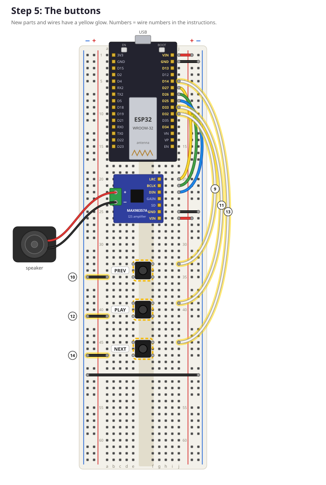
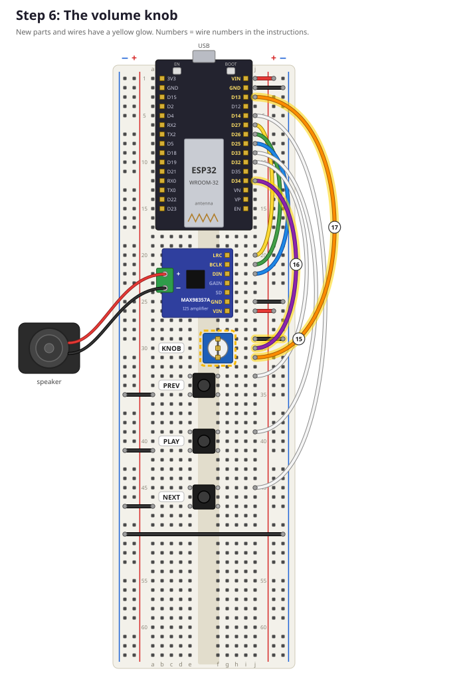
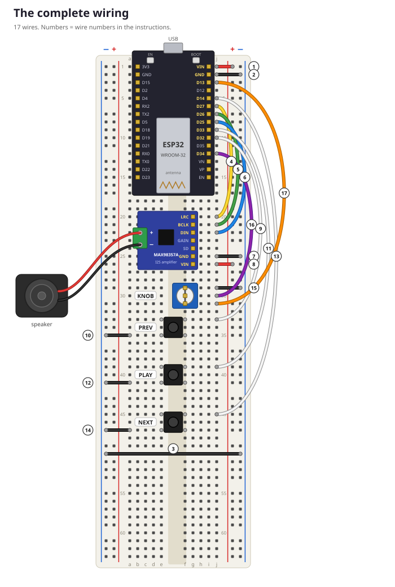

# Lesson 4: Build part 2, buttons and knob

**Goal:** add three buttons and a volume knob, and read them with the ESP32.
**Time:** about 45 minutes. **You need:** your breadboard from lesson 3, 3 buttons, the knob, jumper wires.

> 🔌 **Unplug the USB cable first!**

---

## Step 5: The buttons



### Placing a button
A button has 4 legs. Put it **across the gap in the middle** of the breadboard, so two legs are in column `e` and two in column `f`:

| Button | Legs go into |
|---|---|
| PREV | `e33` `f33` `e35` `f35` |
| PLAY | `e39` `f39` `e41` `f41` |
| NEXT | `e45` `f45` `e47` `f47` |

Push until it clicks in flat. If it doesn't fit, turn it a quarter turn: the legs only fit across the gap one way.

### The diagonal rule
Inside a button, some legs are always connected and some only when you press. That's confusing, so here's a trick that **always works**: **connect your two wires to legs that are diagonally opposite.** We use the **top-right** leg (via column `j`) and the **bottom-left** leg (via column `a`).

| Wire | Colour | From | To | What it does |
|---|---|---|---|---|
| 9 | white | `j10` (D32) | `j33` | PREV top-right leg → ESP32 |
| 10 | black | `a35` | **− rail** on the left, row 35 | PREV bottom-left leg → GND |
| 11 | white | `j9` (D33) | `j39` | PLAY top-right leg → ESP32 |
| 12 | black | `a41` | **− rail** on the left, row 41 | PLAY bottom-left leg → GND |
| 13 | white | `j5` (D14) | `j45` | NEXT top-right leg → ESP32 |
| 14 | black | `a47` | **− rail** on the left, row 47 | NEXT bottom-left leg → GND |

> 💡 The left − rail is GND because of wire 3 from step 2 (the long wire at row 50).

## Step 6: The knob



Put the knob's 3 legs into **column `f`, rows 29, 30 and 31**, between the amplifier and the PREV button, with the turning part facing up.

| Wire | Colour | From | To | What it does |
|---|---|---|---|---|
| 15 | black | `j29` (leg 1) | **− rail** on the right, row 29 | one end of the knob → GND (0 V) |
| 16 | purple | `j30` (middle leg) | `j12` (D34) | the ESP32 measures this leg |
| 17 | orange | `j31` (leg 3) | `j3` (D13) | other end of the knob → 3.3 V from pin D13 |

> 💡 **Why D13 and not the 3V3 pin?** The ESP32's 3V3 pin is on the other side of the board, under the ESP32, where we can't reach it. So the program switches pin D13 on (`HIGH` = 3.3 V) and uses it as a tiny power supply for the knob. The knob only needs a very small current, so that's fine.

## Test it!

1. Plug in the USB cable.
2. Open `firmware/tests/03_buttons_knob/03_buttons_knob.ino` and upload it.
3. Open the **Serial Monitor** (115200 baud).
4. Press each button, and turn the knob from one side to the other.

✅ **Checkpoint:** you see something like this:
```
Button PREV pressed!
Button PLAY pressed!
Button NEXT pressed!
Knob: raw=1834  ->   44%
Knob: raw=4095  ->  100%
```
While you hold a button down, the blue LED on the ESP32 is on.

> 😕 A button doesn't work, or the knob jumps around? See [troubleshooting](troubleshooting.md#buttons-and-knob).

**Do the full player check:** your breadboard should now look exactly like this.



> 🎧 Got the headphone board too? You can add it now or later: [Extra: Headphones](09_extra_headphones.md).

---

## Digital and analog

**Buttons are digital.** A digital signal has only two values: **HIGH** (3.3 V, "1") or **LOW** (0 V, "0").

**The knob is analog.** Its voltage can be *anything* between 0 and 3.3 V. The ESP32 has an **ADC** (Analog-to-Digital Converter) that measures the voltage and turns it into a number from **0** (0 V) to **4095** (3.3 V).

Then this line turns 0–4095 into a percentage:
```cpp
int percent = map(raw, 0, 4095, 0, 100);
```

## Why does a pressed button read LOW?

```cpp
pinMode(PIN_BUTTON_PREV, INPUT_PULLUP);
```

`INPUT_PULLUP` switches on a resistor **inside** the ESP32 that gently pulls the pin up to 3.3 V. So:
- **Not pressed:** nothing is connected, the resistor pulls the pin up → **HIGH**.
- **Pressed:** the button connects the pin straight to GND → **LOW**.

Without the pull-up, a pin that isn't connected to anything "floats": it picks up random noise and reads HIGH or LOW at random. Try it: in the code, change one `INPUT_PULLUP` to `INPUT`, upload, and move your finger near the wire!

## Why D34 for the knob?
The ESP32 has two ADCs: ADC1 and ADC2. **ADC2 stops working when WiFi is on** (the WiFi radio uses it). D34 is on ADC1, so it keeps working while we stream music. That's the kind of detail engineers find in the **datasheet**, the manual for a chip.

## Try it
1. Make the program print `Button PLAY released!` when you let go of the PLAY button. (Hint: look at how "pressed" is detected: `state == LOW && lastState == HIGH`.)
2. Make the LED blink faster when the knob is turned up higher.
3. Count how many times PLAY has been pressed, and print the number.

---

## ✅ What did you learn?
- [ ] The diagonal rule for buttons.
- [ ] Digital = HIGH/LOW, analog = anything in between (0–4095).
- [ ] A pull-up resistor makes a button read HIGH normally and LOW when pressed.
- [ ] Not every pin can do everything: check which pins to use.

## 🤔 Quiz
1. The Serial Monitor shows `Knob: raw=2048`. Roughly what is the voltage on D34?
2. Why do the buttons connect to GND and not to 5 V?
3. What would happen if you connected the knob to D25 (an ADC2 pin) and turned on WiFi?

<details><summary>Answers</summary>

1. About half of 3.3 V, so about 1.65 V.
2. With `INPUT_PULLUP`, the pin is HIGH by itself, so the button has to make it LOW, by connecting to GND. (And 5 V would damage the ESP32's pins, which only handle 3.3 V!)
3. The knob would stop working: ADC2 can't be used while WiFi is on.
</details>

**Next:** [Lesson 5: WiFi](05_wifi.md)
