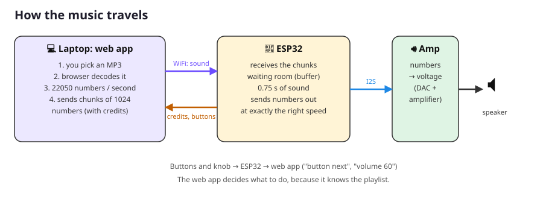

# Lesson 7: How it works

**Goal:** understand what happens between clicking a song and hearing it, and talk to your player yourself.
**Time:** about 45 minutes. **You need:** your working MP3 player and the web app.

---

## 1. From MP3 to numbers (in the browser)

An MP3 file is **compressed**: a clever trick to make the file about 10 times smaller, by leaving out sounds your ears wouldn't notice anyway. The ESP32 could unpack that itself, but it's a lot of work. So we let the browser do it: browsers are very good at this.

Open `webapp/player.js` and find the function `decode`. It does three things:

1. **Decode:** `decodeAudioData` unpacks the MP3 into samples. These are numbers between −1.0 and 1.0, usually 44100 per second, in 2 channels (left and right).
2. **Resample and mix to mono:** we "play" the song into a silent recorder (`OfflineAudioContext`) that records **1 channel at 22050 samples per second**. That's half the original rate, which is plenty for a small speaker and only half the data.
3. **Convert to 16-bit integers:** −1.0 … 1.0 becomes −32768 … 32767, numbers the ESP32 can use directly.

A song of 3 minutes is 3 × 60 × 22050 = **3,969,000 numbers**. Each number takes 2 bytes, so that's almost 8 MB.

## 2. From the browser to the ESP32: a WebSocket

A **WebSocket** is a connection between the browser and the ESP32 that **stays open**. Both sides can send a message at any time. Think of a phone call, compared to sending letters.

We send two kinds of messages:
- **Text messages** are commands, like `volume 50` or `button next`.
- **Binary messages** are sound: **1024 samples** (2048 bytes) per message. We call one message a **chunk**.

### All the commands
| From | Message | Meaning |
|---|---|---|
| web app → player | `start 22050` | a new song is coming, at 22050 samples per second |
| | `pause` / `resume` | pause / continue |
| | `stop` | stop, and throw away the sound in the buffer |
| | `volume 50` | set the volume (0–100) |
| | `ping` | are you there? (the player answers `pong`) |
| | `beep 440 500` | play a tone of 440 Hz for 500 ms (only when no song is playing) |
| | `hello` | the player introduces itself again |
| player → web app | `hello mp3player-1 32768 2048` | "Hi! My name is…, my buffer is 32768 bytes, chunks are 2048 bytes" |
| | `credit 3` | "I've played 3 chunks, you may send 3 more" |
| | `button prev` / `play` / `next` | someone pressed a button on the breadboard |
| | `volume 57` | someone turned the knob |
| | `stopped` | "I've stopped and my buffer is empty" |
| | `underrun` | "Help, my buffer ran empty!" |

## 3. The waiting room: the buffer

WiFi is not perfectly steady. Sometimes messages arrive a bit late, sometimes a few at once. But a speaker needs **exactly 22050 samples every second**, never more and never less. Otherwise you hear clicks and stutters.

The solution is a **buffer**: a waiting room for samples inside the ESP32. It holds 32768 bytes = 16384 samples = **about 0.75 seconds** of music. The web app keeps it filled, and the ESP32 takes samples out at exactly the right speed. If WiFi hiccups for a moment, there's still enough sound in the waiting room.

## 4. Credits: not too much, not too little

But what if the web app sends faster than the speaker plays? Then the waiting room overflows and sound gets lost. That's why we use **credits**, like tokens for a ride at the fair:

1. When a song starts, the web app gets **14 credits**. The buffer fits 16 chunks, and we keep 2 spare to be safe.
2. Sending one chunk costs **one credit**.
3. No credits left? Then the web app **waits**.
4. Every time the speaker has played a chunk, the ESP32 sends a credit back: `credit 1`.

That way there is **never** more sound on its way than fits in the waiting room. 🎟️

## 5. From the ESP32 to the speaker: I2S

In `firmware/mp3_player/audio.cpp`, the **audio task** runs all the time, next to `loop()`. It's like a second worker inside the ESP32. Again and again it:
1. takes 256 samples out of the buffer
2. multiplies them by the volume (`sample * volume / 100`)
3. copies each sample to the left **and** the right channel
4. sends them to the amplifier with `i2s.write()`

`i2s.write()` waits until the amplifier is ready for more. That automatically makes the audio task go at exactly the right speed.

**I2S** uses three wires:
- **BCLK** (bit clock) ticks once for every bit: 22050 samples × 16 bits × 2 channels = **705,600 ticks per second**!
- **LRC** (left/right clock) says whether the current sample is for the left or the right channel.
- **DIN** (data) carries the bits of the samples, one per tick.

The amplifier turns the numbers into a voltage, makes it stronger, and pushes the speaker.

---

## 🔬 Experiments

Open the web app and click **4. Message log**. You'll see every message that goes back and forth.

1. **Talk to your player:** type these commands in the box at the bottom and press **Send**:
   - `ping` → the player answers `pong`
   - `beep 440 500` → a tone! Try `beep 880 500` and `beep 220 1000`.
   - `volume 10`, then `volume 80`
2. **Watch the credits:** play a song and tick **Show credit messages**. How many credits arrive per second? (Hint: 22050 samples per second ÷ 1024 samples per chunk = ?)
3. **Watch the speed:** look at the *Speed* in the statistics. Calculate what it should be: 22050 samples × 2 bytes = ? bytes per second. Divide by 1024 to get KB/s.
4. **Pause and look:** press pause. What happens to the credit messages? What happens to the *Credits* number?
5. **Find your limit:** walk away from the router with the laptop while music plays. Do you ever see *"The player ran out of sound!"*?
6. **Smaller buffer:** in `config.h`, change `BUFFER_BYTES` to `8192` (a quarter) and upload. Does the music still play smoothly? What about `4096`? Then set it back to `32768`.
7. **Serial Monitor:** keep the Serial Monitor open while you use the web app. The ESP32 prints every command it receives (`<- volume 50`).

Answers to experiments 2 and 3

2. 22050 ÷ 1024 ≈ **21.5 credits per second**. They often arrive in groups, like `credit 2`.
3. 22050 × 2 = 44100 bytes per second ÷ 1024 ≈ **43 KB/s**. That's nothing for WiFi: a video call uses about 50 times more!

---

## ✅ What did you learn?
- [ ] The browser decodes the MP3 into samples, and the ESP32 only plays them.
- [ ] A WebSocket stays open, so both sides can send messages at any time.
- [ ] A buffer smooths out the bumps in WiFi.
- [ ] Credits make sure the buffer never overflows.
- [ ] I2S sends sound with three wires: BCLK, LRC and DIN.

## 🤔 Quiz
1. Why don't we just send the whole MP3 file to the ESP32?
2. What would happen without credits, if the web app sent everything as fast as possible?
3. What would happen if the buffer were much smaller, say 0.05 seconds?
4. Who decides which song comes next when you press NEXT on the breadboard: the ESP32 or the web app?

Answers

1. Decoding MP3 is hard work, and the ESP32 would need a lot of extra code. Browsers are made for it. (It *is* possible, and real MP3 players do it!)
2. The buffer would overflow and lots of sound would be thrown away. You'd hear only bits and pieces.
3. Every little WiFi hiccup would make the buffer run empty, and the music would stutter.
4. The web app. The ESP32 only says `button next`. The web app knows the playlist, so it decides what to play.

**Next:** [Lesson 8: Challenges](08_challenges.md)
