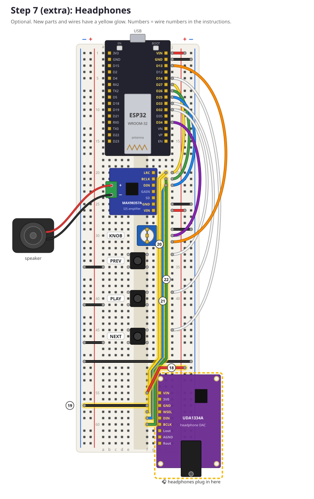

# Extra: Headphones 🎧 (step 7, optional)

**Goal:** add a headphone socket to your player, so you can listen without disturbing anyone.
**Time:** about 45 minutes, including soldering.
**You need:**
- your finished breadboard from lesson 4
- the **UDA1334A DAC** board (purple, with a headphone socket) and its loose pin strips
- 6 jumper wires. 3 of them must be long: they go from row 20 to row 60, so take the longest ones in your pack
- wired headphones or earbuds with a normal 3.5 mm plug
- a soldering iron, solder, and **a grown-up next to you**

You can do this step any time after lesson 4. The player's code doesn't need to change at all!

> 🔌 **Unplug the USB cable first!**

---

## What is a DAC?

**DAC** stands for **D**igital-to-**A**nalog **C**onverter. It turns numbers (digital) into a voltage that goes up and down (analog), and that's what moves a speaker or headphone.

You already have a DAC: it's inside the amplifier. The MAX98357A is a DAC **plus** a strong amplifier for the speaker. The UDA1334A is **only** a DAC. Its signal is much weaker, and that's just right for headphones.

| Board | Turns numbers into… | For |
|---|---|---|
| MAX98357A | a **strong** signal (3 watts) | the speaker |
| UDA1334A | a **weak** signal | headphones |

Both boards listen to the **same three I2S wires** (BCLK, LRC and DIN). Only the ESP32 talks on those wires, and the boards only listen, a bit like two people listening to the same radio station. Wires that one sender shares with several listeners are called a **bus**.

> ⚠️ **Never connect headphones to the amplifier's speaker connector.** It's far too strong: it can hurt your ears and break your headphones.

## Step 7a: Solder the pins (with a grown-up)

The DAC comes with two loose pin strips. You only need the **9-pin strip**, for the row of holes labelled **VIN 3V0 GND WSEL DIN BCLK Lout AGND Rout**. Leave the other row (SCLK, MUTE, SF1, SF0, PLL, DEEM) empty.

1. Push the **long** ends of the 9-pin strip into your breadboard, into **column `h`, rows 55 to 63**. That's where the DAC will live, and the breadboard holds the pins nice and straight.
2. Put the DAC on top, **labels facing up**: the short pin ends poke through the 9 holes from VIN to Rout. The board lies over the right edge of the breadboard, with the headphone socket pointing away from it.
3. Solder **one pin at the end** first. Hold the iron against the pin **and** the copper ring around it for 2 seconds, then touch the solder to them (not to the iron). Take the solder away, then the iron.
4. Check that the board lies flat. If it doesn't, heat that pin again and push the board flat (careful, the pin gets hot!).
5. Solder the other 8 pins.

✅ **Check:** every joint looks like a small, shiny **volcano** 🌋. A blob that looks like a ball, or solder that connects two pins, needs fixing. Ask your grown-up.

> 🔥 **Soldering safety:**
> - The tip of the iron is about 350 °C. Only hold the handle, and always put it back in its stand.
> - Don't breathe the smoke. Open a window, or blow it away gently.
> - Wash your hands afterwards.

## Step 7b: Place the DAC and wire it up



If you soldered it on your breadboard, the DAC is already in the right place. If not, put its pins into **column `h`, rows 55 to 63**, with **VIN at row 55** (toward the ESP32).

Check the labels: 55 = **VIN**, 56 = 3V0, 57 = **GND**, 58 = **WSEL**, 59 = **DIN**, 60 = **BCLK**, 61 = Lout, 62 = AGND, 63 = Rout.

The wires go into **column `f`**, because `g` is too close to the edge of the board. That works because `f`, `g` and `h` in the same row are connected.

| Wire | Colour | From | To | What it does |
|---|---|---|---|---|
| 18 | red | **+ rail** on the right, row 51 | `f55` (VIN) | 5 V power for the DAC |
| 19 | black | **− rail** on the left, row 57 | `f57` (GND) | ground for the DAC |
| 20 | yellow | `i20` (amp LRC) | `f58` (WSEL) | "left or right?" clock |
| 21 | blue | `i22` (amp DIN) | `f59` (DIN) | the sound data |
| 22 | green | `i21` (amp BCLK) | `f60` (BCLK) | bit clock |

3V0, Lout, AGND and Rout stay **empty**. They're for other projects, and the headphone socket is already connected to Lout and Rout on the board.

> 💡 **Why `i20`, `i21` and `i22`?** Holes `f` to `j` in row 20 are connected to the amplifier's LRC pin, and wire 4 connects that pin to D27 on the ESP32. So `i20` *is* D27! The DAC gets exactly the same signals as the amplifier. (`j20` is taken by wire 4, and `f20` is under the amplifier, so we use `i`.)

> 💡 **WSEL** means **W**ord **SEL**ect. It's just another name for LRC: different factories use different names for the same thing.

✅ **Check:**
- [ ] Wire 18 goes into the rail next to the **red** line, and wire 19 into the rail next to the **blue** line.
- [ ] Wires 21 and 22 **cross**. That's correct! The DAC has DIN before BCLK, the amplifier has BCLK before DIN.
- [ ] Count the rows of wires 20, 21 and 22 at both ends.

## Step 7c: Test it! 🎵

1. Plug in the USB cable.
2. Upload `firmware/tests/02_first_sound` again.
3. Plug in your headphones, but **don't put them on yet**: hold them a little away from your ear first.

✅ **Checkpoint:** you hear the melody from the speaker **and** from both sides of your headphones.

Then upload `firmware/mp3_player` again and play some music from the web app. The speaker and the headphones play together, and the buttons and knob work just like before.

> 😕 Nothing in your headphones? See [troubleshooting → headphones](troubleshooting.md#headphones).

## Speaker off: one extra wire

The speaker keeps playing along with the headphones. To switch it off, add one more black wire:

| Wire | Colour | From | To | What it does |
|---|---|---|---|---|
| 23 | black | `j24` (amp SD) | **− rail** on the right, row 23 | switches the amplifier off |

**SD** means **S**hut**D**own. Connected to GND, the amplifier switches off. Pull out the wire and the speaker plays again. That's your speaker switch!

## 🎧 Protect your ears

Ears can't be repaired, so take care of them:
- Start with the volume at **20 or lower**, and turn it up slowly.
- If someone next to you can hear your music, it's too loud.
- Take a break every hour.

---

## Why do both ears hear the same thing?

The web app sends **mono** sound: one channel. In `firmware/mp3_player/audio.cpp`, the audio task copies every sample into the left **and** the right channel:

```cpp
stereo[i * 2] = sample;        // left
stereo[i * 2 + 1] = sample;    // right
```

The speaker amplifier mixes left and right together anyway. But the DAC sends left to your left ear and right to your right ear. So with headphones, **real stereo** is possible! That's a challenge in [lesson 8](08_challenges.md#-real-stereo-for-headphones).

## Try it
1. Make the left ear silent: in `audio.cpp`, change the left line to `stereo[i * 2] = 0;`. Upload, and play a song. Put it back afterwards!
2. With wire 23 in place, run `02_first_sound`. Is it quiet now? Pull out wire 23 while it plays.

---

## ✅ What did you learn?
- [ ] A DAC turns numbers into a voltage.
- [ ] I2S is a bus: one sender, and several boards can listen.
- [ ] How to solder a pin strip.
- [ ] Stereo means a different signal for left and right.

## 🤔 Quiz
1. What's the difference between the MAX98357A and the UDA1334A?
2. Why didn't we need to change any code?
3. Wire 20 could also go into `h20` instead of `i20`. Why?
4. Why must the 5 V + rail never touch an ESP32 pin, while it's fine for the DAC's VIN?

<details><summary>Answers</summary>

1. Both are DACs, but the MAX98357A also has a strong amplifier for a speaker. The UDA1334A only makes a weak signal, which is enough for headphones.
2. The DAC understands the same I2S signals as the amplifier, and it listens to the same three wires.
3. `f20` to `j20` are all connected, so any free hole in that row works.
4. ESP32 pins only handle 3.3 V. The DAC's VIN is made for 3 to 5 V: the board has its own small regulator that turns it into the voltage it needs.
</details>

**Back to:** [the lesson list](../README.md#lessons)
